<p align="center">
  
</p>

<h1 align="center">HearthNG for webOS</h1>

<p align="center">
  <strong>Next-Generation, ultrafast and calm home screen launcher for LG webOS TVs.</strong><br>
  Engineered for pure OLED black, instant responsiveness, and deep hardware control.
</p>

<p align="center">
  <a href="README.md"><strong>English</strong></a> | <a href="README.ru.md"><strong>Русский</strong></a>
</p>

<p align="center">
  <a href="https://github.com/emoorpheus/HearthNG/releases/latest"></a>
  
  
  <a href="LICENSE"></a>
</p>

---

<p align="center">
  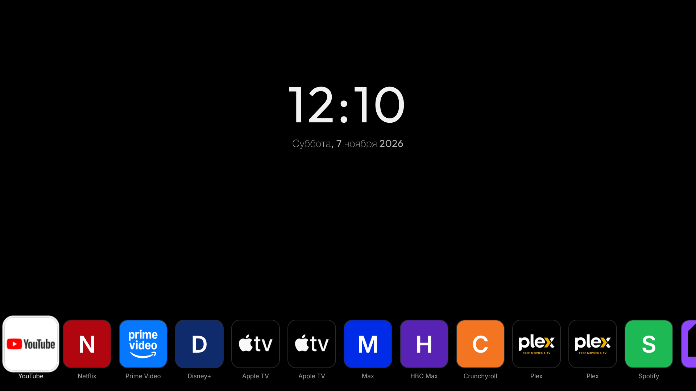
</p>

## Overview

**HearthNG** is a modernized, independent fork of [Hearth for webOS](https://github.com/rudra-avatar/Hearth), designed to liberate LG Smart TVs from bloated, advertising-heavy, and sluggish factory interfaces.

Where stock LG Home bombards you with sponsored banners, auto-playing video teasers, and multi-row carousels, HearthNG delivers instantaneous boot times, fluid 60/120 fps animations, a minimalist clock and weather widget, and single-row app access — all navigation operable with standard directional keys or the Magic Remote pointer.

---

## What Sets HearthNG Apart (Key Innovations)

### 1. webOS 24/25 Boot Race Condition Elimination (`Helper 18-ng5`)
On modern LG webOS versions (webOS 24 and 25, such as OLED C4, G4, and M5 series), LG Home was converted into an isolated background Flutter process (`flutter-client -i com.webos.app.home`). On stock launchers, a severe race condition occurred: if you turned on the TV and immediately opened an app or switched inputs, LG SAM (`LAUNCH_LASTAPP`) spawned LG Home in the background, which then violently popped up over your active app and terminated it.

HearthNG introduces the **Helper 18-ng5** architecture:
- **`boot_freeze_monitor`**: Freezes `flutter-client` with a targeted `SIGSTOP` signal during boot until the system completely settles.
- **`collision recovery`**: Continuously monitors window focus and instantly recovers your foreground app if LG Home attempts to steal focus.
- **Adaptive `empty_counts` polling**: Reduces CPU overhead to virtually zero during idle.
- **Watchdog Supervisor (`guard.sh`)**: Recovers the helper automatically if terminated, with graceful fallback.

### 2. Active HDMI Signal Indicator
<p align="center">
  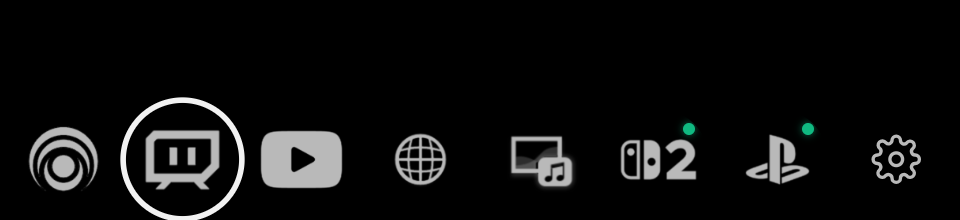
</p>

HearthNG polls real-time hardware status via webOS External Input Manager (`com.webos.service.eim/getAllInputStatus`). When a connected console (PlayStation 5, Nintendo Switch, Xbox) or PC is powered on and transmitting an active video stream, a vivid **neon-green status LED** illuminates directly on its HDMI tile. 

> You can see at a glance whether your gaming PC or console is awake before switching inputs.

### 3. Block LG OTA Update Pop-ups (Rooted TVs)
<p align="center">
  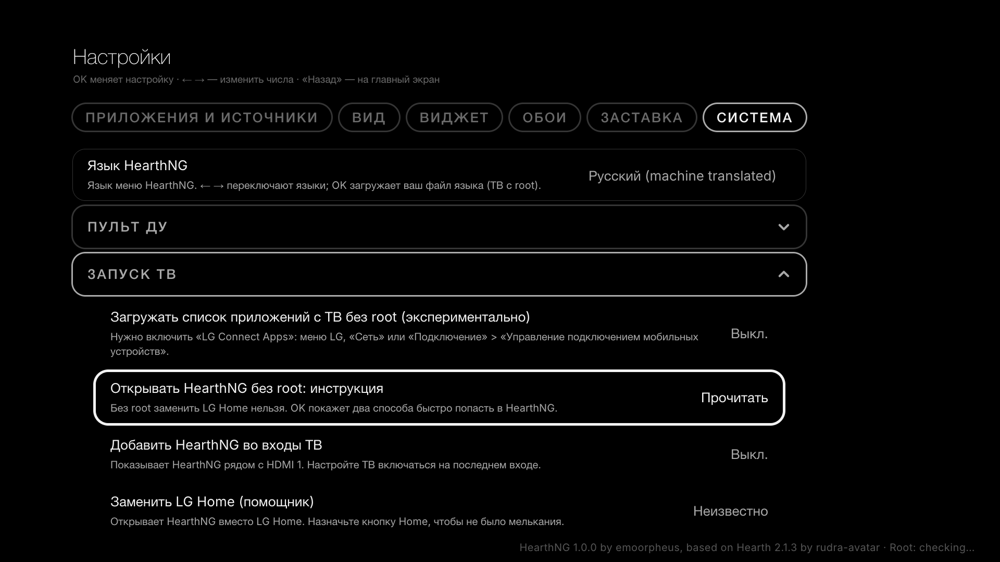
</p>

Firmware updates from LG frequently patch root exploits and break custom Homebrew Channel services. HearthNG includes a one-click toggle in *Settings &rarr; System &rarr; TV start* that halts and disarms `/usr/sbin/update`, shielding your TV against involuntary OTA updates while keeping all homebrew services active.

### 4. Pure OLED Black Architecture
Designed specifically for high-end OLED displays (LG OLED B/C/G/M series, Titan Army Mini-LED):
- Flat, true `#000000` pitch black background without gray gradients, noise, or light bleeding.
- Maximizes OLED pixel shut-off for infinite contrast, lower power consumption, and zero burn-in risk.
- Minimalist typography and crisp monochrome glyph options.

### 5. Magic Remote Quiet Mode Guard
Prevents inadvertent cursor hovering or micro-movements from waking up hidden rows or disrupting ambient clock viewing.

### 6. FitScale for Low-Resolution Displays
Dynamic viewport auto-scaling ensures that 720p and 768p secondary displays render with identical crisp proportions as native 1080p and 4K displays.

### 7. Full Native Russian & English Bilingual Support
Includes 100% complete, professionally written localization for all interfaces, settings menus, help descriptions, error messages, and emergency recovery terminal scripts.

---

## Hardware In Action

Direct screenshot captured live from an **LG OLED 65M59LA** running webOS 25 with active HDMI signals detected on Nintendo Switch 2 and PlayStation 5:

<p align="center">
  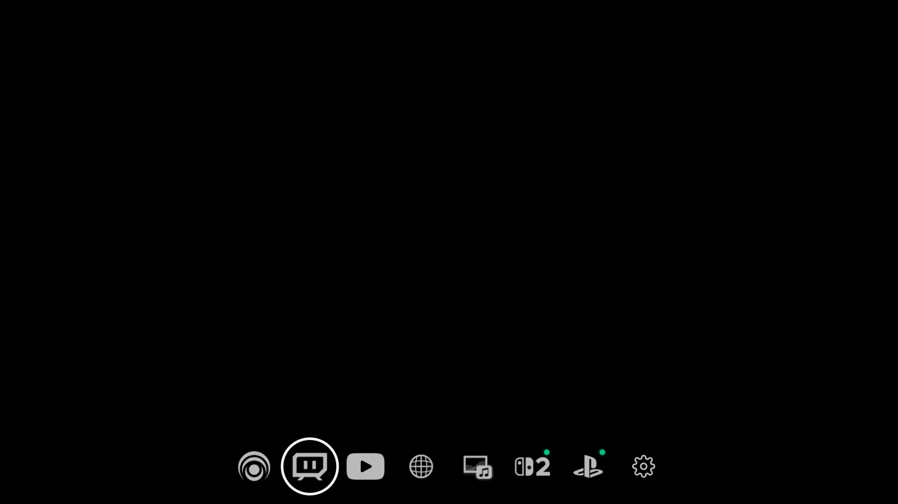
</p>

---

## Visual Styles & Customization

HearthNG adapts to your aesthetic preference with rich personalization options:

| Minimalist OLED Black | Dynamic Wallpaper & Scrim |
|:---:|:---:|
| 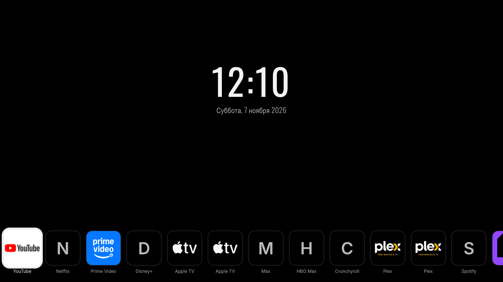 | 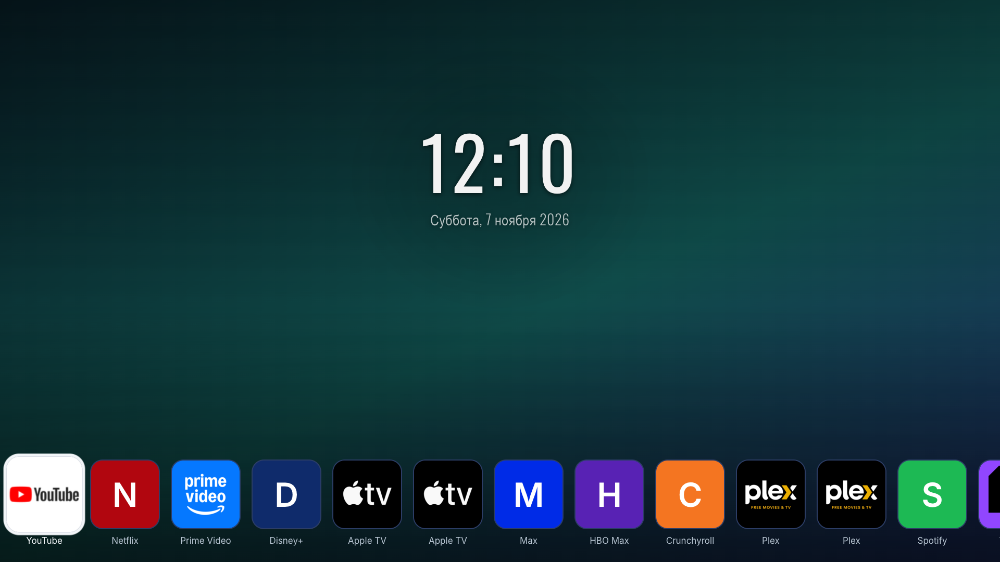 |
| **Pure #000 with monochrome glyphs** | **25 curated photos, USB slideshow, custom gradients** |

| Quiet Mode (Clock & Date Only) | Recent Apps Task Switcher |
|:---:|:---:|
| 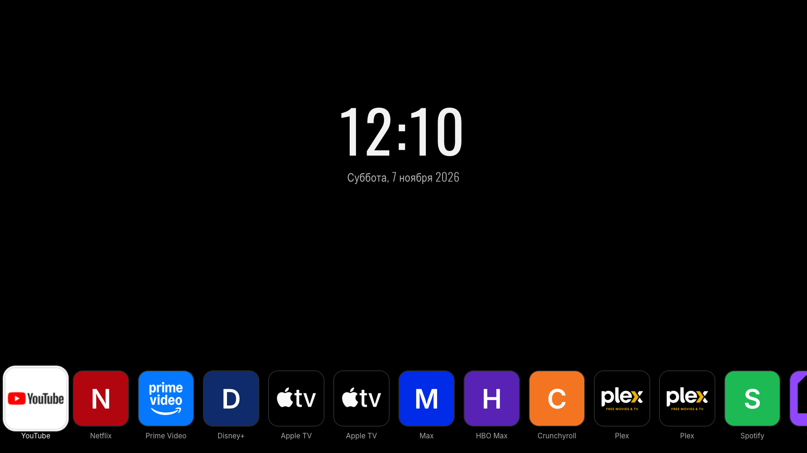 | 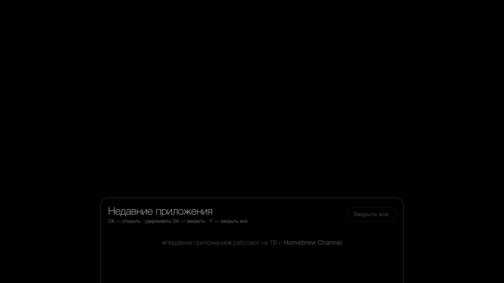 |
| **Hides tiles after inactivity to protect OLED panels** | **Instant access to active applications with "Close All"** |

---

## Settings & Controls Gallery

All settings are configured directly from your remote control:

| Apps & Sources Management | Look, Themes & Typography |
|:---:|:---:|
| 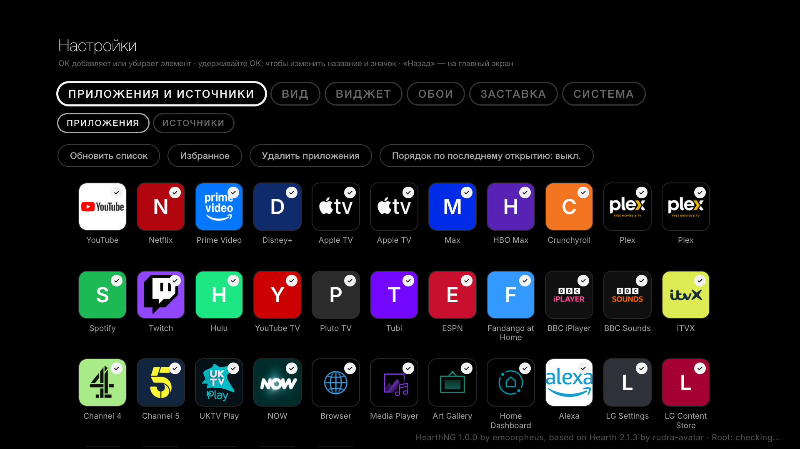 | 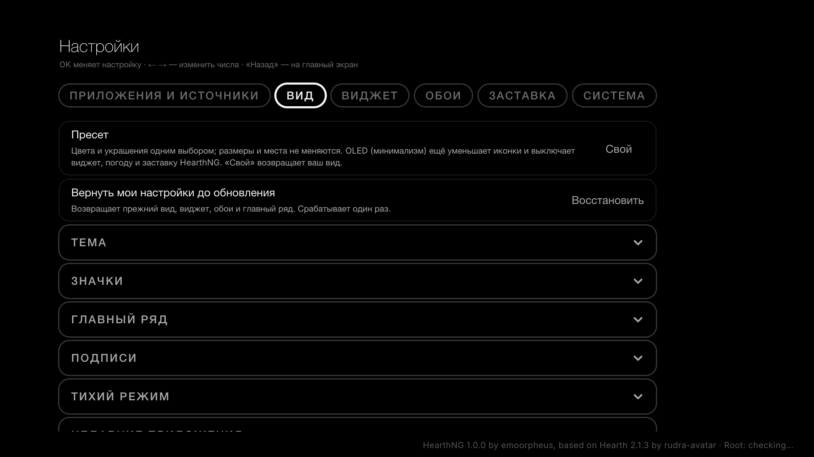 |
| **Reorder, hide, favorite, or rename tiles** | **Themes, tile shapes, margins, custom fonts** |

| Clock & Weather Widget | System & Root Control |
|:---:|:---:|
| 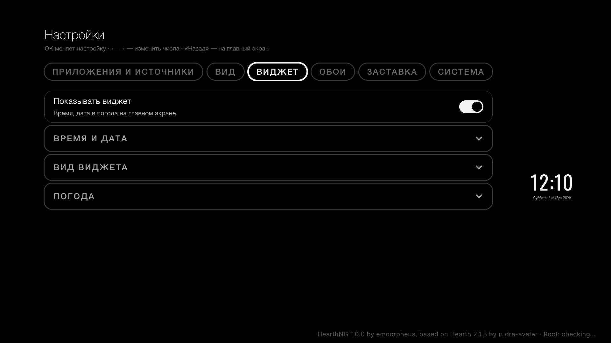 | 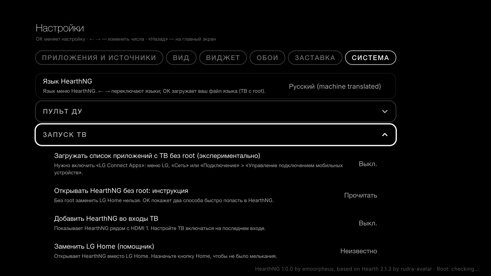 |
| **12/24h format, shadow, live local weather** | **LG Home replacement, update blocker, auto-start** |

---

## Compatibility

HearthNG supports all LG webOS versions from legacy platforms up to latest models:

| Platform | Target TVs | Core Launcher | Replace LG Home | Active HDMI LED | Update Blocker |
|---|---|:---:|:---:|:---:|:---:|
| **webOS 24 / 25+** | LG OLED B4, C4, G4, M4, B5, C5, G5, M5 | :white_check_mark: | :white_check_mark: *(Helper 18-ng5)* | :white_check_mark: | :white_check_mark: |
| **webOS 22 / 23** | LG OLED C2, G2, C3, G3, QNED series | :white_check_mark: | :white_check_mark: | :white_check_mark: | :white_check_mark: |
| **webOS 5.x / 6.x** | LG OLED CX, GX, C1, G1 (2020–2021) | :white_check_mark: | :white_check_mark: | :white_check_mark: | :white_check_mark: |
| **webOS 3.x / 4.x** | Legacy webOS models (Chromium 38/53) | :white_check_mark: *(ES5 polyfill)* | :white_check_mark: *(SAM/bootd)* | :white_check_mark: | :white_check_mark: |

*Note: Core launcher functionality works on all TVs (even unrooted via webOS Developer Mode). System-level hooks (replacing LG Home, blocking updates, power-on app) require root privileges via Homebrew Channel.*

---

## Installation

### Method 1: webOS Dev Manager (Recommended)
1. Download the latest `com.hearthng.launcher_1.0.0_all.ipk` from [Releases](https://github.com/emoorpheus/HearthNG/releases/latest).
2. Open **webOS Dev Manager** on your PC/Mac.
3. Click **Install**, choose the `.ipk` file, and wait for confirmation.

### Method 2: Command Line (SSH)
On a rooted TV or via Developer Mode:

```bash
# Copy package to TV
scp com.hearthng.launcher_1.0.0_all.ipk root@<TV_IP>:/tmp/

# SSH into TV and install
ssh root@<TV_IP>
luna-send -w 60000 -i luna://com.webos.appInstallService/dev/install \
  '{"id":"com.ares.defaultName","ipkUrl":"/tmp/com.hearthng.launcher_1.0.0_all.ipk","subscribe":true}'
```

---

## Emergency Recovery (SSH)

If you ever experience issues with home screen replacement or screen freezes, you can immediately restore default TV behavior over SSH:

```bash
# Emergency disable: terminates helper, watchdog, and unfreezes stock LG Home
sh /media/developer/launcher-homehook/stop.sh

# Re-enable HearthNG helper
sh /media/developer/launcher-homehook/stop.sh resume
```

---

## Building from Source

```bash
# Clone repository
git clone https://github.com/emoorpheus/HearthNG.git
cd HearthNG

# Install dependencies
npm install

# Run development server with mock environment
npm run dev

# Run comprehensive test suite (70 test files)
npm test

# Build production bundle and package IPK
npm run build
npm run package
```

Built packages will be generated in the root directory:
- `com.hearthng.launcher_1.0.0_all.ipk`
- `com.hearthng.toast_1.0.0_all.ipk`

---

## Authors & Credits

- **HearthNG**: emoorpheus.
- **Hearth for WebOS**: [rudra-avatar](https://github.com/rudra-avatar/Hearth) and upstream contributors.
- **Original concept**: Based originally on `partridgeworks/webos-launcher`.

## License

Distributed under the **MIT License**. See [`LICENSE`](LICENSE) for complete terms.
