<p align="center">
  
</p>

<h1 align="center">HearthNG для webOS</h1>

<p align="center">
  <strong>Современный, ультрабыстрый и лаконичный домашний экран (лаунчер) для телевизоров LG webOS.</strong><br>
  Создан для чистого чёрного цвета на OLED, мгновенного отклика и полного контроля над аппаратной частью ТВ.
</p>

<p align="center">
  <a href="README.md"><strong>English</strong></a> | <a href="README.ru.md"><strong>Русский</strong></a>
</p>

<p align="center">
  <a href="https://github.com/emoorpheus/HearthNG/releases/latest"></a>
  
  
  <a href="LICENSE"></a>
</p>

---

<p align="center">
  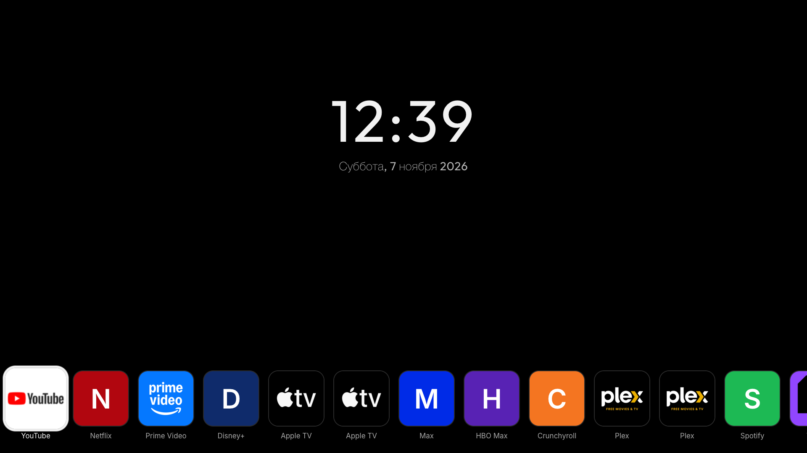
</p>

## Обзор проекта

**HearthNG** — это глубоко модернизированный независимый форк лаунчера [Hearth for webOS](https://github.com/rudra-avatar/Hearth), созданный для освобождения смарт-телевизоров LG от перегруженного, медлительного и переполненного рекламой стандартного интерфейса.

В то время как заводской LG Home навязывает спонсорские баннеры, трейлеры с автовоспроизведением и бесконечные ряды рекомендаций, HearthNG обеспечивает мгновенный старт, плавные 60/120 кадров в секунду, аккуратный виджет часов и погоды, а также удобный однострочный список приложений — с полным управлением как кнопками пульта, так и курсором Magic Remote.

---

## Ключевые особенности и инновации HearthNG

### 1. Устранение состояния гонки при старте webOS 24/25 (`Помощник 18-ng5`)
В современных версиях webOS (webOS 24 и 25 на линейках OLED C4, G4, M5 и др.) стандартный LG Home был перенесён в изолированный фоновый Flutter-процесс (`flutter-client -i com.webos.app.home`). На оригинальном Hearth это вызывало критический баг: при включении ТВ и немедленном запуске приложения системный демон SAM (`LAUNCH_LASTAPP`) в фоне вызывал LG Home, который затем принудительно перекрывал активное приложение пользователя и аварийно закрывал его.

В HearthNG реализована новая архитектура **Помощника 18-ng5**:
- **`boot_freeze_monitor`**: Замораживает процесс `flutter-client` точечным сигналом `SIGSTOP` на этапе ранней загрузки ТВ до полной стабилизации системы.
- **`collision recovery`**: Непрерывно отслеживает фокус окон и мгновенно восстанавливает пользовательское приложение на передний план, если LG Home попытался перехватить экран.
- **Адаптивный опрос `empty_counts`**: Снижает нагрузку на процессор до нуля в режиме ожидания.
- **Сторожевой процесс (`guard.sh`)**: Автоматически перезапускает помощник в случае сбоя с безопасным аварийным выходом.

### 2. Светодиодный индикатор активного видеосигнала HDMI
<p align="center">
  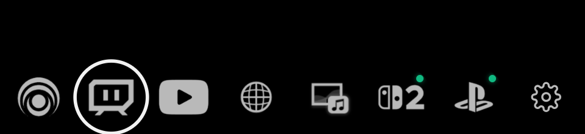
</p>

HearthNG опрашивает аппаратный статус портов External Input Manager (`com.webos.service.eim/getAllInputStatus`). Когда подключённая консоль (PlayStation 5, Nintendo Switch, Xbox) или ПК включены и передают активный видеосигнал, прямо на соответствующей плитке входа зажигается яркий **зелёный индикатор активности**.

> Вам больше не нужно переключаться на порт HDMI вслепую, чтобы проверить, проснулась ли консоль или компьютер.

### 3. Блокировка всплывающих окон обновления LG (для ТВ с Root)
<p align="center">
  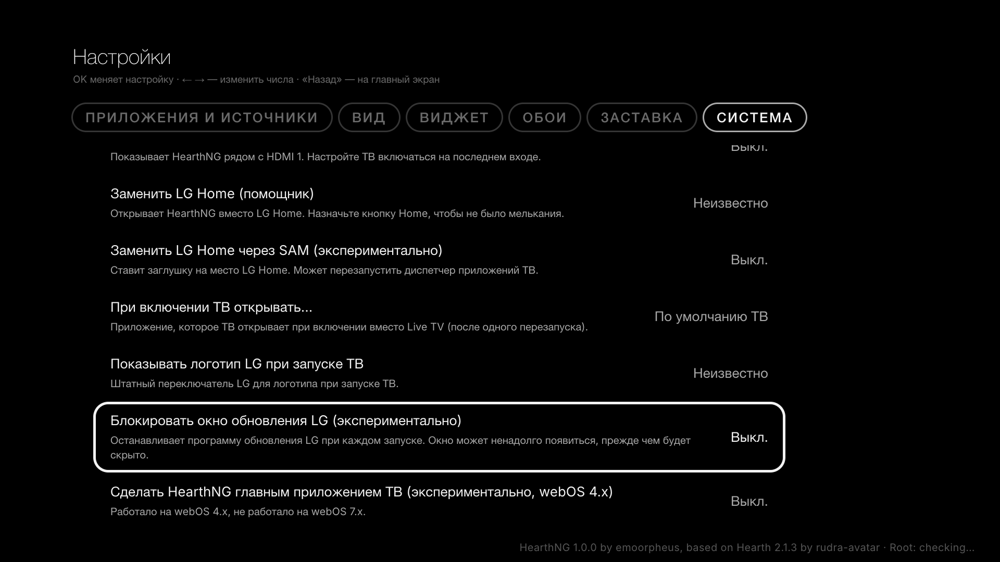
</p>

Системные обновления прошивки от LG часто закрывают уязвимости root-доступа и ломают сервисы Homebrew Channel. В HearthNG встроен переключатель в один клик в разделе *Настройки &rarr; Система &rarr; Запуск ТВ*, который блокирует системный апдейтер `/usr/sbin/update`, гарантируя защиту от нежелательных OTA-обновлений при сохранении работы всех homebrew-компонентов.

### 4. Дизайн Pure OLED Black
Специальная калибровка под высококлассные OLED-экраны (серии LG OLED B/C/G/M, Mini-LED):
- Абсолютно чистый чёрный фон `#000000` без серых градиентов, шума и засветов.
- Максимальное отключение пикселей OLED: бесконечная контрастность, снижение энергопотребления ТВ и исключение риска выгорания матрицы.
- Аккуратная типографика и чёткие монохромные пиктограммы.

### 5. Защита курсора Magic Remote (Quiet Mode Guard)
Предотвращает случайное пробуждение скрытых рядов и мерцание интерфейса при непреднамеренном движении аэромыши в руках.

### 6. Масштабирование FitScale для компактных экранов
Динамическое масштабирование позволяет комфортно использовать HearthNG на телевизорах с разрешением ниже 1080p (720p и 768p) без искажения пропорций интерфейса.

### 7. Полная нативная русская и английская локализация
Интерфейс содержит качественный, профессиональный перевод всех настроек, подсказок, системных уведомлений и терминальных команд восстановления.

---

## Работа на реальном железе

Прямой снимок экрана с телевизора **LG OLED 65M59LA** (webOS 25) с активными сигналами HDMI на консолях Nintendo Switch 2 и PlayStation 5:

<p align="center">
  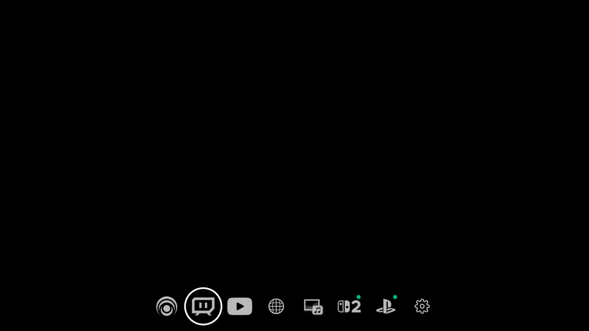
</p>

---

## Внешний вид и варианты оформления

HearthNG легко настраивается под любой вкус:

| Минималистичный OLED Black | Живые обои и градиенты |
|:---:|:---:|
| 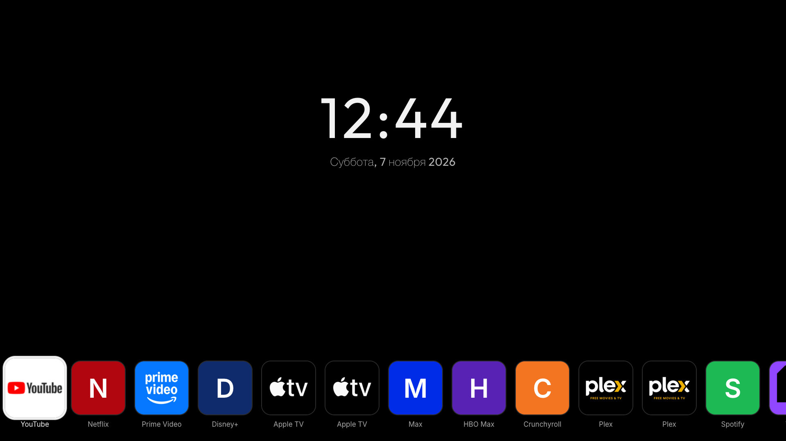 | 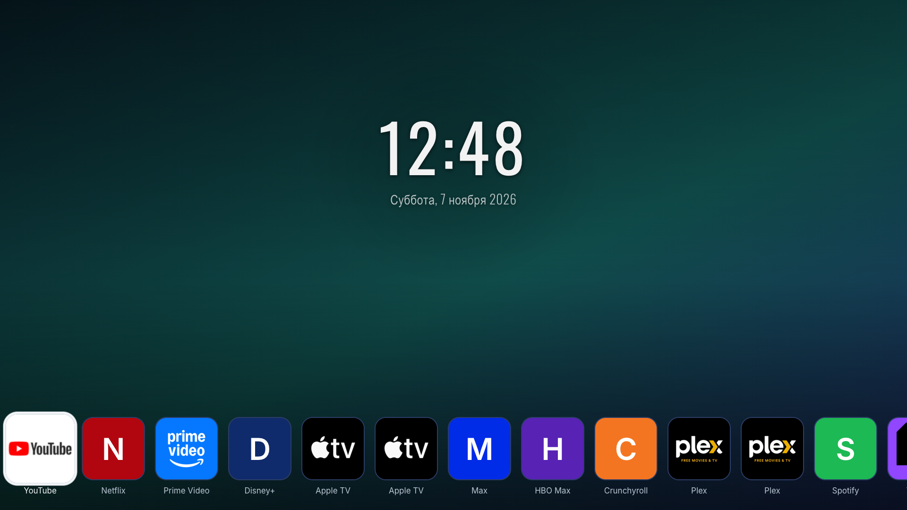 |
| **Чистый #000 и монохромные значки** | **25 встроенных фото, слайдшоу с USB, градиенты** |

| Тихий режим (только часы и дата) | Панель недавних приложений |
|:---:|:---:|
| 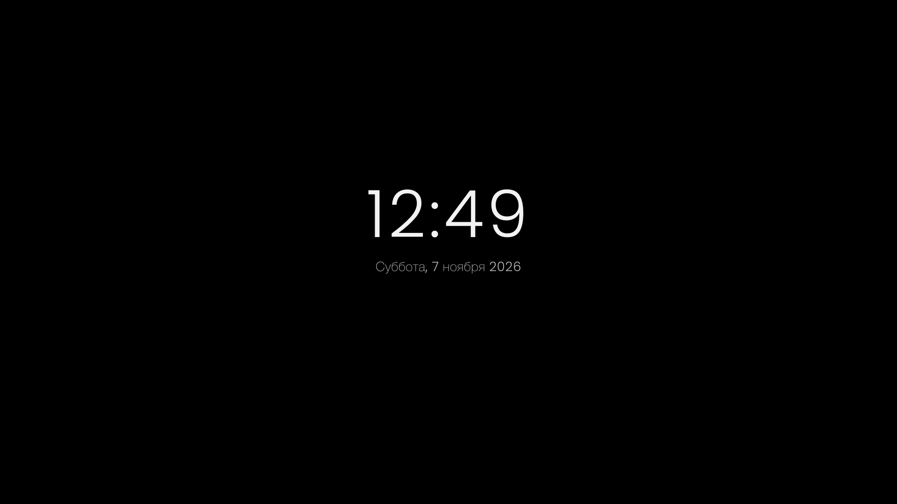 | 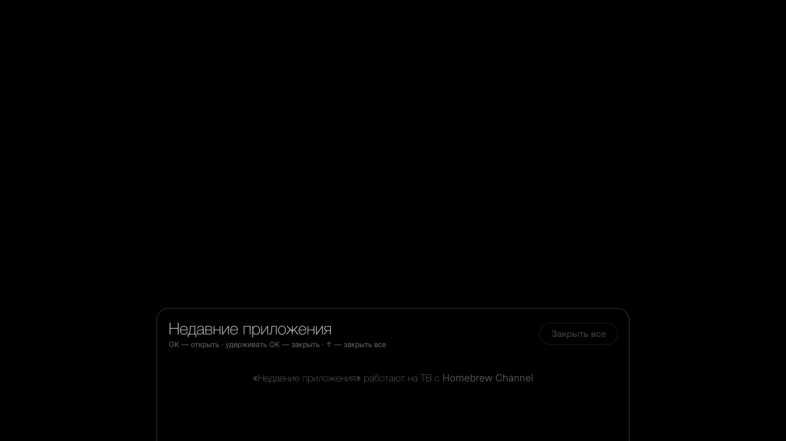 |
| **Скрытие плиток при бездействии для защиты OLED** | **Быстрое переключение с кнопкой «Закрыть все»** |

---

## Меню настроек и управление

Все параметры удобно настраиваются прямо с пульта ДУ:

| Управление приложениями и входами | Внешний вид, темы и шрифты |
|:---:|:---:|
| 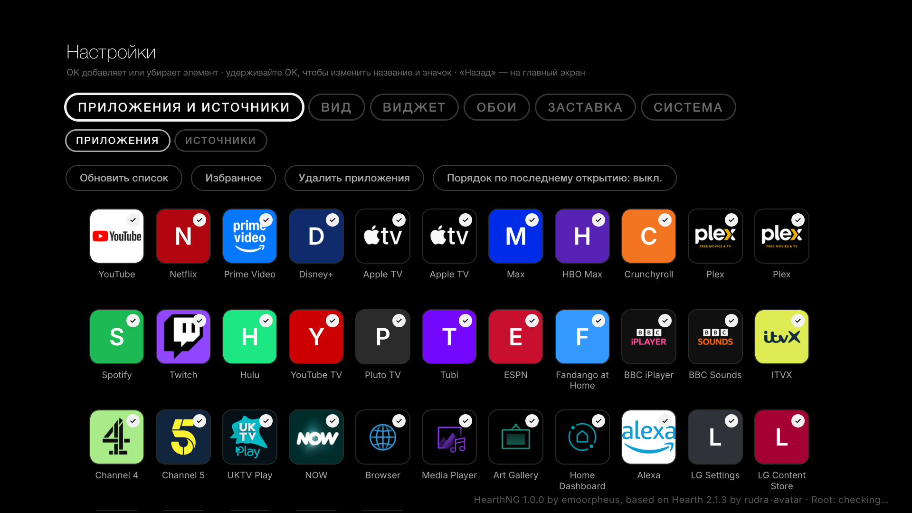 | 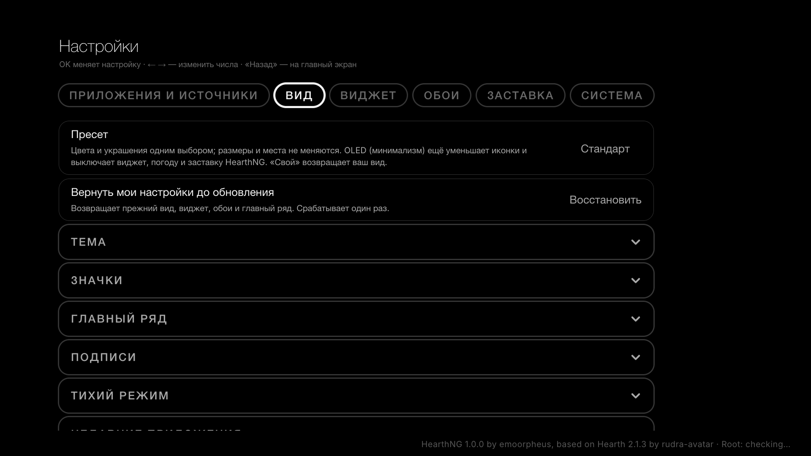 |
| **Сортировка, скрытие, избранное, переименование** | **Темы, форма плиток, отступы, шрифты часов** |

| Виджет часов и погоды | Системные опции и Root |
|:---:|:---:|
| 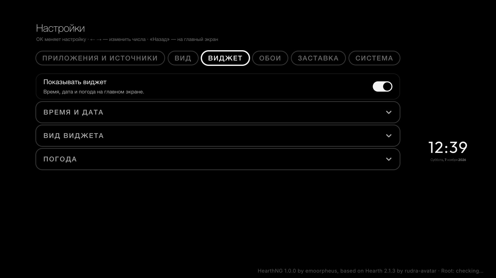 | 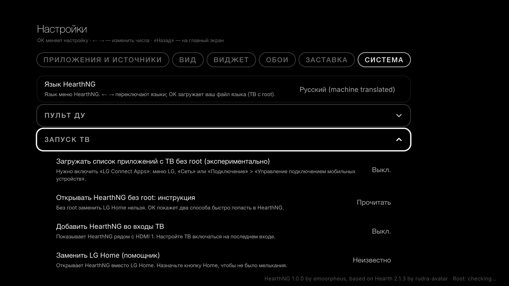 |
| **Формат времени, тень, прогноз погоды онлайн** | **Замена LG Home, блокировка обновлений, автозапуск** |

---

## Таблица совместимости

HearthNG поддерживает всю линейку webOS от ранних моделей до новейших флагманов:

| Платформа | Модели ТВ | Лаунчер | Замена LG Home | Индикатор HDMI | Блокировка OTA |
|---|---|:---:|:---:|:---:|:---:|
| **webOS 24 / 25+** | LG OLED B4, C4, G4, M4, B5, C5, G5, M5 | :white_check_mark: | :white_check_mark: *(Helper 18-ng5)* | :white_check_mark: | :white_check_mark: |
| **webOS 22 / 23** | LG OLED C2, G2, C3, G3, линейка QNED | :white_check_mark: | :white_check_mark: | :white_check_mark: | :white_check_mark: |
| **webOS 5.x / 6.x** | LG OLED CX, GX, C1, G1 (2020–2021) | :white_check_mark: | :white_check_mark: | :white_check_mark: | :white_check_mark: |
| **webOS 3.x / 4.x** | Старые модели webOS (Chromium 38/53) | :white_check_mark: *(ES5 полифил)* | :white_check_mark: *(SAM/bootd)* | :white_check_mark: | :white_check_mark: |

*Примечание: Базовый функционал лаунчера работает абсолютно на всех ТВ (включая телевизоры без root через режим разработчика Developer Mode). Системные функции перехвата кнопки Home, автозапуска и блокировки обновлений требуют root-прав через Homebrew Channel.*

---

## Установка

### Способ 1: webOS Dev Manager (Рекомендуется)
1. Скачайте свежий пакет `com.hearthng.launcher_1.0.0_all.ipk` со страницы [Релизов](https://github.com/emoorpheus/HearthNG/releases/latest).
2. Запустите **webOS Dev Manager** на ПК или Mac.
3. Нажмите кнопку **Install**, выберите `.ipk` файл и дождитесь завершения установки.

### Способ 2: Через консоль по SSH
На телевизоре с root или через Developer Mode:

```bash
# Копируем пакет на телевизор
scp com.hearthng.launcher_1.0.0_all.ipk root@<IP_ТЕЛЕВИЗОРА>:/tmp/

# Подключаемся по SSH и выполняем установку через системный сервис
ssh root@<IP_ТЕЛЕВИЗОРА>
luna-send -w 60000 -i luna://com.webos.appInstallService/dev/install \
  '{"id":"com.ares.defaultName","ipkUrl":"/tmp/com.hearthng.launcher_1.0.0_all.ipk","subscribe":true}'
```

---

## Аварийное восстановление (SSH)

Если после экспериментов с перехватом экрана что-то пошло не так, вы всегда можете мгновенно вернуть стандартное поведение ТВ по SSH:

```bash
# Аварийная остановка: завершает помощник, сторож и размораживает стандартный LG Home
sh /media/developer/launcher-homehook/stop.sh

# Возобновление работы помощника HearthNG
sh /media/developer/launcher-homehook/stop.sh resume
```

---

## Сборка из исходного кода

```bash
# Клонирование репозитория
git clone https://github.com/emoorpheus/HearthNG.git
cd HearthNG

# Установка зависимостей
npm install

# Запуск локального dev-сервера с mock-окружением
npm run dev

# Прогон полного набора тестов (70 тест-сьютов)
npm test

# Сборка production-билда и упаковка IPK
npm run build
npm run package
```

Собранные готовые пакеты появятся в корневой папке проекта:
- `com.hearthng.launcher_1.0.0_all.ipk`
- `com.hearthng.toast_1.0.0_all.ipk`

---

## Авторы и благодарности

- **Автор HearthNG**: [emoorpheus](https://github.com/emoorpheus) — архитектура Next-Gen, фикс состояния гонки webOS 24/25 (`18-ng5`), светодиодный индикатор активного видеосигнала HDMI, блокировка обновлений LG, калибровка чистого OLED Black, полная русская локализация.
- **Оригинальный проект Hearth**: [rudra-avatar](https://github.com/rudra-avatar/Hearth) и контрибьюторы апстрима.
- **Основа**: Исторически основано на `partridgeworks/webos-launcher`.

## Лицензия

Распространяется под свободной лицензией **MIT License**. Подробности в файле [`LICENSE`](LICENSE).
